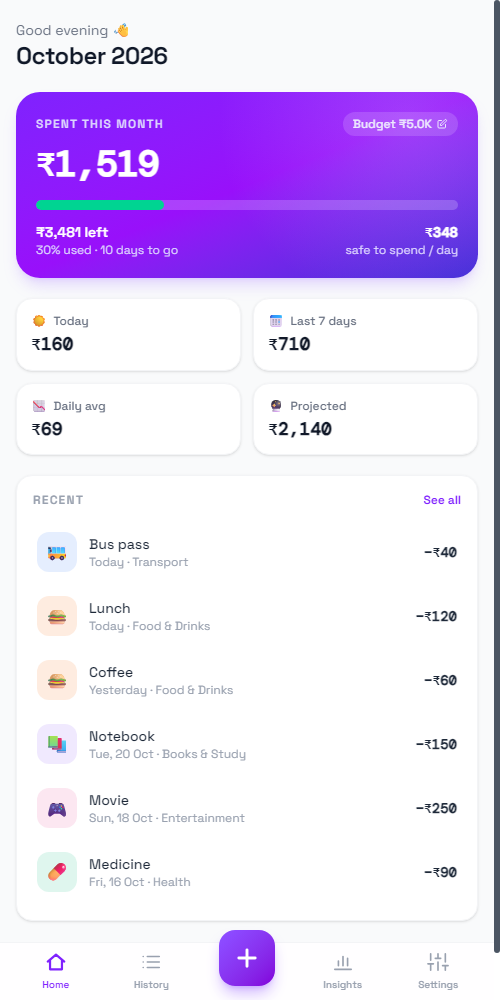
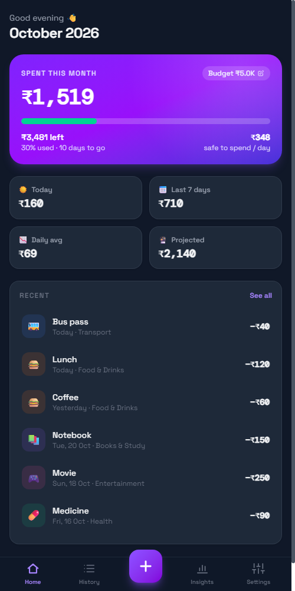

# 💸 Student Expense Tracker

[](https://github.com/SujanTheMagician/Expense-Tracker/actions/workflows/android.yml)
[](https://github.com/SujanTheMagician/Expense-Tracker/actions/workflows/deploy.yml)
[](https://github.com/SujanTheMagician/Expense-Tracker/releases/latest)

A personal finance tracker for students, built by **Sujan Anandh** — 3rd Year B.Tech CSE at AMET University & Intern at ATIUM Sports.

Runs as an **Android app** and on the **web**. All data stays on your device.

<p align="center">
  
  &nbsp;&nbsp;
  
</p>

## 📲 Download

- **Android:** grab `ExpenseTracker-x.y.z.apk` from the [latest release](https://github.com/SujanTheMagician/Expense-Tracker/releases/latest), open it on your phone and allow "Install unknown apps" when asked. New releases install over the old one and keep your data.
- **Web:** [sujanthemagician.github.io/Expense-Tracker](https://sujanthemagician.github.io/Expense-Tracker/)

> The web version and the app keep separate data. To move data across, use **Settings → Back up data** on one and **Restore from backup** on the other.

## ✨ Features

- **App-style layout** — bottom tabs (Home · History · Insights · Settings) with a big **+** button
- **Quick add** — amount-first entry sheet, Today/Yesterday date chips, and one-tap shortcuts from past expenses
- **Edit & delete** — tap any expense to edit it; deletes can be undone
- **Monthly budget** with a "safe to spend per day" figure and end-of-month projection
- **Insights** — browse any month: category doughnut, daily spending bars, month-over-month change
- **History** — grouped by month and day, search by name or note, filter by category, sort by amount
- **Export to CSV** and **backup / restore** (JSON) — uses the Android share sheet inside the APK
- **Dark mode** (follows the system by default)
- **Works offline** — fonts are bundled, data stays in localStorage on the device
- **Android APK** via Capacitor, with hardware back-button support

## 🛠️ Tech Stack

- React 19 + Vite
- Tailwind CSS v4
- Chart.js
- Capacitor 7 (Android)
- localStorage for persistence

## 🚀 Getting Started

```bash
npm install
npm run dev
```

## 📱 Building the Android APK

### Automatically (GitHub Actions)

Every push to `main` builds an APK — open the run under **Actions** and download it from **Artifacts**.

To publish a release, bump `version` in `package.json` and push a matching tag:

```bash
git tag v1.1.0
git push origin v1.1.0
```

The workflow builds a signed APK and attaches it to a new GitHub Release.

Release APKs are signed with a key stored in these repository secrets: `ANDROID_KEYSTORE_BASE64`, `ANDROID_KEYSTORE_PASSWORD`, `ANDROID_KEY_ALIAS`, `ANDROID_KEY_PASSWORD`. Without them the workflow falls back to a debug build. Keep a backup of the keystore — Android only installs an update if it's signed with the same key.

### Locally

Requires JDK 21 and the Android SDK (platform 35).

```bash
npm run android:sync     # build the web app and copy it into android/
cd android
./gradlew assembleDebug  # gradlew.bat on Windows
```

The APK is written to `android/app/build/outputs/apk/debug/app-debug.apk`. Run `npm run android:open` to open the project in Android Studio instead.

App icons and the launch screen are generated from `assets/` with `npx capacitor-assets generate --android`.

## 🗂️ Project Structure

```
src/App.jsx              the whole app — screens, sheets, charts, helpers
src/index.css            Tailwind setup and animations
android/                 Capacitor Android project
assets/                  source images for the app icon and launch screen
capacitor.config.json    app id, name and Android settings
.github/workflows/       APK build/release and GitHub Pages deploy
```

## 🌐 Web Deploy

`.github/workflows/deploy.yml` publishes the web version to GitHub Pages on every push to `main` (Pages source: **GitHub Actions**).

## 👤 About

- **Sujan Anandh** — [GitHub](https://github.com/SujanTheMagician) · [LinkedIn](https://www.linkedin.com/in/sujan-anandh-227253212)
- 3rd Year B.Tech CSE, AMET University
- Software Development Intern, ATIUM Sports
